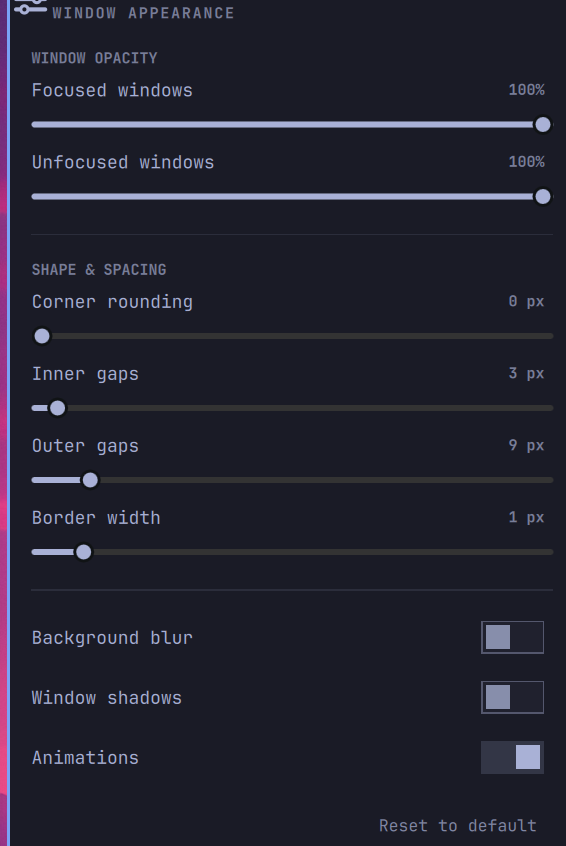

# Desktop Controls

An [Omarchy](https://omarchy.org/) shell plugin: a bar button that opens a panel
for tuning Hyprland window appearance **live** — window opacity, corner
rounding, gaps, border width, blur, shadows and animations — without touching a
config file.



## Controls

| Section | Control | Hyprland option |
|---|---|---|
| Window opacity | Focused windows (%) | `decoration:active_opacity` |
| Window opacity | Unfocused windows (%) | `decoration:inactive_opacity` |
| Shape & spacing | Corner rounding (px) | `decoration:rounding` |
| Shape & spacing | Inner gaps (px) | `general:gaps_in` |
| Shape & spacing | Outer gaps (px) | `general:gaps_out` |
| Shape & spacing | Border width (px) | `general:border_size` |
| Effects | Background blur | `decoration:blur:enabled` |
| Effects | Window shadows | `decoration:shadow:enabled` |
| Effects | Animations | `animations:enabled` |

Plus **Reset to default**, which restores the values captured the first time the
plugin ran.

## Install

```bash
omarchy plugin add https://github.com/paulsamoluk/Desktop_Controls.git --enable
omarchy bar move psamoluk.desktop-controls --section right
```

(It lands in the section its manifest asks for; move it if you'd rather have it
elsewhere.)

Or by hand: clone into `~/.config/omarchy/plugins/psamoluk.desktop-controls`,
then `omarchy-shell shell rescanPlugins` and `omarchy plugin enable
psamoluk.desktop-controls`.

The plugin lands disabled so you can read the code before enabling it — it runs
unsandboxed inside `omarchy-shell`, as every shell plugin does.

## How it works

**Reads** use `hyprctl -j getoption <key>` (JSON), so the sliders always show
what the compositor is actually doing rather than what the plugin last sent.

**Writes** use `hyprctl eval 'hl.config({ ... })'`. They cannot use
`hyprctl keyword`: on a Lua-configured Hyprland it is refused outright —

```
$ hyprctl keyword decoration:rounding 12
keyword can't work with non-legacy parsers. Use eval.
```

Only the option being changed is included in each `hl.config()` call, so one
slider never disturbs the rest of the desktop.

**Persistence.** Values are written into this widget's own entry in
`~/.config/omarchy/shell.json` (the documented place for per-instance plugin
settings), alongside a `base*` snapshot of the desktop as it was before the
plugin first changed anything — that snapshot is what *Reset to default* restores.

**Drift.** Hyprland forgets runtime `hl.config()` changes whenever it reloads its
config (theme switch, editing a `.lua` file, `omarchy restart hyprctl`). The bar
widget re-states the saved values when the shell starts and checks the
compositor every few seconds, so tuning sticks instead of silently reverting.

## Requirements

Omarchy 4 (the Lua-config Hyprland, where `hyprctl eval` is the runtime config
path) on x86_64 or aarch64. Nothing else — the plugin calls `hyprctl` and `sh`
from the shell, no external packages.

## Dependencies, privileges and safety

Written out because the marketplace asks for it, and because a plugin runs
unsandboxed inside the long-lived `omarchy-shell` process.

- **External commands:** `hyprctl` (ships with Hyprland) and `sh`, invoked by
  name. No downloads, no remote builds, no installers, no background services.
- **Network:** none. The plugin never talks to anything.
- **Privileges:** none. It runs entirely as your user and never calls `sudo`.
- **What it writes:** Hyprland's runtime configuration via `hl.config()`, and its
  own settings inline in your `~/.config/omarchy/shell.json` widget entry through
  the shell's own API. Nothing else — no files outside the plugin folder, no
  system paths, no shell rc files.
- **Install:** `omarchy plugin add` only clones files into
  `~/.config/omarchy/plugins/<id>/`; the shell never executes plugin code during
  install, and this plugin declares no hooks or post-install scripts.
- **State on disk:** `~/.config/omarchy/shell.json` (the widget entry: your tuned
  values plus a `base*` snapshot for Reset). No other files are created.

## Remove

```bash
omarchy plugin remove psamoluk.desktop-controls
```

That deletes the plugin folder and its bar entry, and because the saved values
live inline on that entry, they go with it.

One honest caveat: removal does not reach into the compositor and undo a tuning
that is currently in effect. The values your desktop is using right now stay in
effect until Hyprland next loads its config (a logout/reboot, or
`omarchy restart hyprctl`), at which point your `.lua` files take over again. To
put the compositor back immediately before removing, use **Reset to default**.

## Validate

```bash
omarchy plugin validate ~/.config/omarchy/plugins/psamoluk.desktop-controls
qmllint -I "$OMARCHY_PATH/shell" \
  ~/.config/omarchy/plugins/psamoluk.desktop-controls/{BarWidget,Panel}.qml
```

Both exit without error. `qs.*` imports are a Quickshell runtime mapping, so
`qmllint` needs an import root containing a `qs` symlink to `$OMARCHY_PATH/shell`
to resolve them the way the shell does; without it the module-import warnings
cascade into false positives on every type.

## License

MIT — see [LICENSE](LICENSE).
